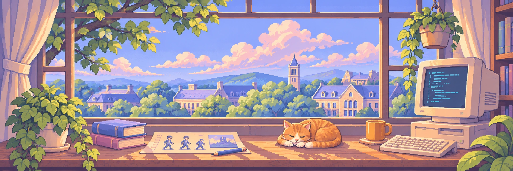

## 你好，我是 hash-distill 👋

我在东北师范大学做全栈开发，最近在写两个和科研、教学有关的工具。

- **[细胞知镜 · CellLens](https://github.com/hash-distill/celllens-platform)**　比较扰动前后的单细胞表达变化，把感兴趣的基因画成图。
- **[精析智评](https://github.com/hash-distill/Class-Knowledge-Graph)**　把课堂转写和课件排到同一条时间轴上，点一个知识点就能回看对应的课堂片段。

[Bilibili](https://space.bilibili.com/671294001) · [邮箱](mailto:zhanghs233@nenu.edu.cn)

<picture>
  <source media="(prefers-color-scheme: dark)" srcset="https://raw.githubusercontent.com/hash-distill/hash-distill/output/github-contribution-grid-snake-dark.svg" />
  
</picture>

技术栈与 GitHub 统计

**后端**　Python · FastAPI · Java · Spring 
**前端与桌面**　TypeScript · Vue · React · Tauri 
**数据与工具**　MySQL · Docker · Git · Linux

  
  

